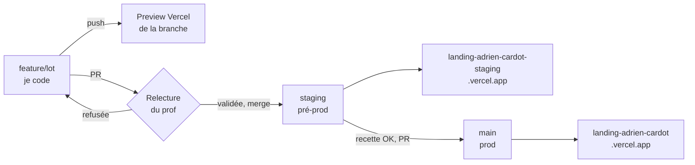
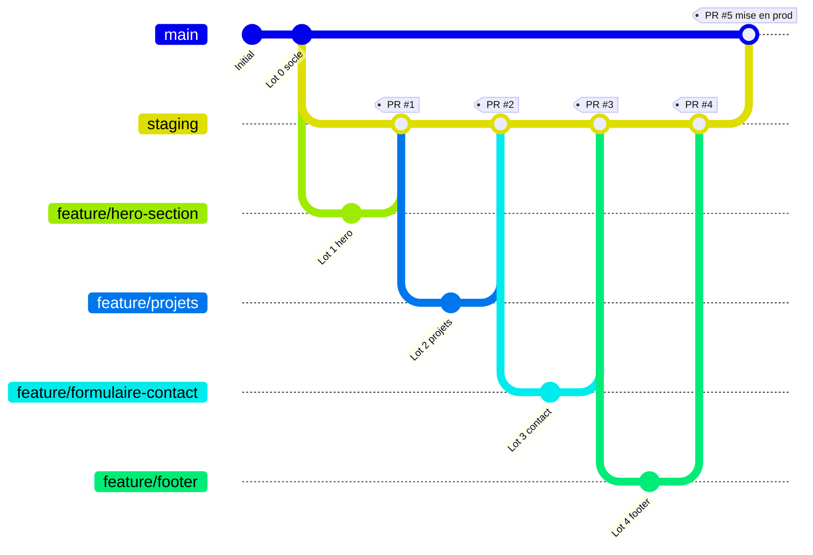

# Schéma de travail

## Le circuit d'un lot

## L'historique des branches

## Qui fait quoi

| Étape | Branche | Où on la voit | Qui valide |
|---|---|---|---|
| Je code un lot | `feature/...` | preview Vercel de la branche | moi |
| PR du lot | `feature/...` → `staging` | page de la PR | le prof |
| Recette | `staging` | adresse staging | moi |
| Mise en prod | `staging` → `main` | adresse de prod | le prof |

Un commit = une version. Vercel affiche le début du hash du commit sur chaque déploiement, c'est ce numéro qui sert de numéro de version.

## Découpage de la page en lots

| Lot | Branche | Section | Fichiers |
|---|---|---|---|
| 0 | `main` | squelette | `index.html`, `css/base.css` |
| 1 | `feature/hero-section` | hero | `css/hero.css` |
| 2 | `feature/projets` | projets | `css/projets.css` |
| 3 | `feature/formulaire-contact` | contact | `css/contact.css`, `js/contact.js` |
| 4 | `feature/footer` | footer | `css/footer.css` |
| 5 | `feature/services` | ce que je fais | `css/services.css` |

Chaque section a son bloc balisé dans `index.html` et son propre CSS, donc deux lots ne touchent jamais les mêmes lignes.

Maquette de la page : [maquette.svg](maquette.svg)
